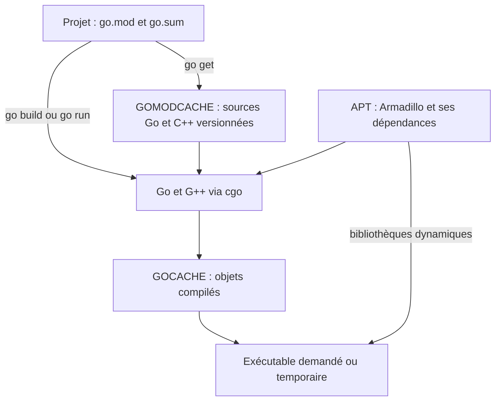

# K-means pour Go

Branche `codex/kmeans-only` ; préversion **`v0.2.0-kmeans.2`** des deux modules.
Cette branche conserve uniquement k-means de mlpack C++ 4.8.0, compilé
automatiquement par cgo : **une unité C++ au lieu de 49**.

## Installation sur Ubuntu 26.04

Avec Go 1.27.3 ou ultérieur installé et depuis un projet possédant son `go.mod` :

```sh
sudo apt-get update
sudo apt-get install --no-install-recommends build-essential libarmadillo-dev ca-certificates
go get github.com/milvi/mlpack-go@v0.2.0-kmeans.2
```

Cette préversion se demande explicitement ; `@latest` privilégie la version
stable existante. Conserver `go.mod` et `go.sum` dans le projet.
Un nouveau projet commence par `go mod init exemple/monprojet`.
Gonum v0.17.0 est la version minimale ; Go utilise une seule version par chemin
de module et retient une version plus récente déjà demandée par le projet.

Les fonctions conservées sont `Cluster`, `ClusterDense`, `DefaultOptions` et leurs
types `Options` et `Result`. Les anciennes fonctions générées, dont `Kmeans`, sont
retirées. Cela constitue une réduction de l’API de la branche précédente.

## Un appel et des slices Go

```go
package main

import (
    "fmt"
    mlpack "github.com/milvi/mlpack-go"
)

func main() {
    points := []float64{0, 0, 0, 1, 10, 10, 10, 11}
    resultat, err := mlpack.Cluster(points, 2, 2, nil)
    if err != nil { panic(err) }
    fmt.Println(resultat.Centers, resultat.Labels, resultat.Converged)
}
```

Une ligne est un point : le tableau contient n × dimensions coordonnées.
Par défaut : dual-tree avec KD-tree, graine 42, un budget de 20 secondes, seuil
global de déplacement des centres 10⁻⁵ et un thread. `DefaultOptions` permet de
changer ces valeurs ; `InitialCentroids` fournit une initialisation explicite.
`Algorithm: "naive"` garde le Lloyd naïf comme référence via la même fonction.
`ClusterDense` accepte Gonum, y compris les vues dont le pas mémoire n’est pas contigu.

Les entrées restent inchangées. Le C++ copie les données, calcule, écrit les
sorties et détruit ses ressources avant le retour. Les résultats appartiennent
à Go ; aucun pointeur natif à restituer, aucun `Close`. Les erreurs C++ deviennent
`error`. Le budget `MaxDuration` inclut préparation et attente du verrou.
À expiration, `errors.Is(err, mlpack.ErrTimeLimit)` est vrai et seules les
statistiques, dont `Iterations`, sont conservées ; les slices du résultat sont
nil et `Converged` est faux. Aucun plafond d’itérations n’est utilisé.
L’arrêt est coopératif dans le C++ : une opération mémoire indivisible et la
destruction des ressources peuvent faire légèrement dépasser le budget.
Le calcul natif est terminé avant le retour, sans goroutine abandonnée.
Les coordonnées et calculs doivent rester finis ; réduire leur échelle si nécessaire.

Les centres vides restent en place pendant les itérations, puis sont retirés au
retour. Les étiquettes sont renumérotées ; le nombre de classes peut être inférieur
à k. `KeepEmptyClusters` conserve les centres vides au retour. L’affectation finale
utilise une recherche exacte par KD-tree, dans l’ordre initial des points.
Les appels natifs sont sérialisés pour protéger les réglages partagés d’OpenMP
et de journalisation, restaurés au retour.

## Lancer les exemples depuis ce dépôt

```sh
go run ./examples/kmeans
go run ./cmd/kmeans -n 100000 -k 1000 -max-duration 20s
```

`go run` compile dans un répertoire temporaire et utilise le cache Go, sans
laisser d’exécutable dans le projet. Pour produire un binaire explicitement :

```sh
go build -o /tmp/kmeans-exemple ./examples/kmeans
/tmp/kmeans-exemple
go build -o /tmp/kmeans ./cmd/kmeans
/tmp/kmeans -n 1000000 -k 1000 -max-duration 20s
```

La commande rend du JSON, y compris à expiration (`timed_out: true`, code de
sortie 124 pour le binaire). `iterations` compte les tours terminés ; aucun
résultat partiel n’est présenté comme une partition valide.

```go
options := mlpack.DefaultOptions()
options.MaxDuration = 5 * time.Second // import "time"
resultat, err := mlpack.Cluster(points, 2, 100, &options)
if errors.Is(err, mlpack.ErrTimeLimit) { // import "errors"
    fmt.Println("Budget atteint après", resultat.Iterations, "itérations")
}
```

## Installation, compilation et fichiers



| Emplacement habituel | Contenu | Gestionnaire |
|---|---|---|
| `/usr/bin`, `/usr/include`, `/usr/lib` | Compilateur, Armadillo, BLAS/LAPACK et dépendances | APT/dpkg |
| `go env GOMODCACHE`, habituellement `~/go/pkg/mod` | Sources Go et C++ des modules versionnés | Go |
| `go env GOCACHE`, habituellement `~/.cache/go-build` | Objets réutilisables | Go |
| Répertoire temporaire du système | Compilation et exécutable de `go run` | Go |
| Chemin choisi avec `go build -o` | Exécutable conservé | Go |

Aucun installateur, `env.sh`, SDK Go privé, CMake ni bibliothèque mlpack séparée.
Aucune modification de la configuration du shell ou du chargeur système.
Le binaire contient le code mlpack mais dépend des bibliothèques système indiquées
par `ldd`. Une machine de compilation a besoin des paquets `-dev` ; une machine
d’exécution a besoin de leurs bibliothèques compatibles.

Le cache suit le contenu des sources et des en-têtes mlpack imbriqués ; un
nouveau compilateur Go ou un changement de source déclenche les actions
nécessaires. Un commit Git seul ne force pas la recompilation du C++.
`go.sum` contrôle l’intégrité des modules téléchargés ; il est distinct de la
clé du cache. Après mise à jour des dépendances natives APT, utiliser
`go build -a ./...` pour forcer la reconstruction.

## Tests et maintenance

```sh
go test -timeout 90s ./...
GOEXPERIMENT=cgocheck2 go test -timeout 90s ./...
go test -timeout 90s -tags mlpack_memtest -run TestNative -v .
```

Le [rapport](docs/corrections-et-validation.md) décrit les résultats exécutés,
la réduction du source et les limites. La recette Docker et GitHub Actions
reproduisent Ubuntu 26.04 ; ils ne sont pas requis pour importer le module.
La [procédure de maintenance](rel/deployment.md) décrit le travail dans les deux dépôts.
