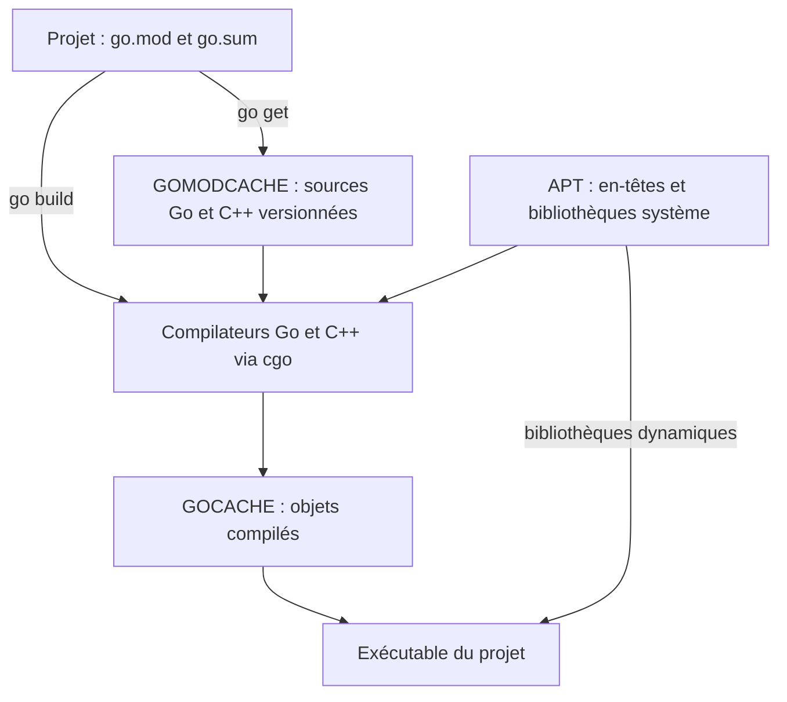

# mlpack pour Go : compilation automatique du C++

Module `github.com/milvi/mlpack-go`, basé sur **mlpack 4.8.0**, avec **Go 1.27.3**
et **Gonum v0.17.0**. Le code natif est un second module :
[`github.com/milvi/mlpack`](https://github.com/milvi/mlpack).
Les deux versions de module sont indépendantes de la version amont C++.

## Installation sur Ubuntu 26.04 amd64

Avec Go installé et depuis le projet qui possède déjà son `go.mod` :

```sh
sudo apt-get update
sudo apt-get install --no-install-recommends build-essential libarmadillo-dev libensmallen-dev libcereal-dev ca-certificates
go get github.com/milvi/mlpack-go@v0.1.0
go build -p 2 ./...
```

Gonum v0.17.0 est la version minimale demandée par ce module et la dernière
version publiée vérifiée le 8 novembre 2026. Une version plus récente déjà
demandée par le projet est conservée.
`@latest` demande la dernière version publiée au moment de la commande.
`go get github.com/milvi/mlpack-go` utilise aussi la version de module retenue
par Go, sans checkout Git manuel. Conserver `go.mod` et `go.sum` dans le projet.
Un nouveau projet commence par `go mod init exemple/monprojet`.

La première compilation construit encore les 46 méthodes historiques et les
utilitaires communs. Elle prend plusieurs minutes et de la mémoire. Sur une
petite machine : `go build -p 2 ./...` limite les compilations simultanées.
Les compilations suivantes utilisent le cache standard de Go.

**Aucun installateur, patch à appliquer, `env.sh`, SDK Go privé, CMake ou `.so`
mlpack à installer.** Seule APT demande les droits administrateur. Helix utilise
l’environnement Go normal du projet. Les autres méthodes restent disponibles ;
l’extraction future de k-means constitue une autre étape.

## Un appel, des slices conservées par Go

```go
package main

import (
    "fmt"
    mlpack "github.com/milvi/mlpack-go"
)

func main() {
    points := []float64{0, 0, 0, 1, 10, 10, 10, 11} // n lignes de d coordonnées
    resultat, err := mlpack.Cluster(points, 2, 2, nil)
    if err != nil { panic(err) }
    fmt.Println(resultat.Centers, resultat.Labels)
}
```

Par défaut : dual-tree avec **KD-tree** (arbre de partition par coordonnées),
initialisation reproductible sans remise, graine 42, un thread, au plus
1000 itérations et seuil de déplacement global des centres 10⁻⁵.
`DefaultOptions()` permet de modifier ces valeurs ; `InitialCentroids` fournit
une initialisation explicite et `ClusterDense` accepte une matrice Gonum,
y compris une vue avec un pas mémoire non contigu.

Le C++ copie les entrées, calcule, écrit dans les slices de sortie Go et détruit
ses arbres et matrices avant le retour. Il ne conserve aucun pointeur Go.
Aucun `Close` n’est nécessaire pour `Result`. Les étiquettes sont des `int`.
L’appel rend aussi inertie, nombre d’itérations et indicateur de convergence.
Une limite d’itérations atteinte donne `Converged == false` : le résultat ne
constitue pas alors un point fixe. Les coordonnées et les calculs doivent rester
finis ; changer l’échelle des données en cas de débordement.

Les centres vides restent à leur place pendant les itérations, puis sont retirés
au retour ; les étiquettes sont renumérotées. `KeepEmptyClusters` conserve ces
centres au retour. Le nombre de classes effectivement rendu peut donc être
inférieur à k. L’affectation finale utilise une recherche exacte avec KD-tree.

Les conversions historiques copient aussi les matrices d’entrée dans une mémoire
possédée par le C++. Un modèle ne peut ainsi conserver un emprunt vers une slice
Go après le retour. Aucun `runtime.Pinner` persistant n’est nécessaire ; cgo épingle
automatiquement les arguments pendant chaque appel.

Les appels natifs sont sérialisés pour protéger l’état partagé historique de
mlpack. Les réglages de journalisation et d’OpenMP sont restaurés par `Cluster`.
OpenMP est l’interface de parallélisme C++ ; le choix `Threads: 1` évite la
surallocation de threads par défaut. Les vieux appels restent accessibles sous
leurs noms d’origine, par exemple `Kmeans`. Leurs exceptions deviennent des
`panic(error)` pour conserver leurs signatures. Chaque modèle opaque historique
possède maintenant `Close() error` : tous ses alias partagent sa durée de vie ;
fermer l’un ferme les autres. Un nettoyage automatique sert de dernier recours.

## Où vont les fichiers ?



Le même schéma est proposé dans [quiver](docs/installation-quiver.md).

| Emplacement habituel | Contenu | Qui écrit ? |
|---|---|---|
| `/usr/bin`, `/usr/include`, `/usr/lib` | GCC/G++, make, Armadillo, ensmallen, cereal et dépendances BLAS/LAPACK, etc. | APT/dpkg |
| `go env GOMODCACHE`, habituellement `~/go/pkg/mod` | Sources téléchargées des modules, dont le C++ mlpack | Go |
| `go env GOCACHE`, habituellement `~/.cache/go-build` | Objets Go/C++ et résultats de compilation réutilisables | Go |
| Répertoire temporaire du système | Travail intermédiaire d’une compilation | Go |
| Projet | `go.mod`, `go.sum` et exécutable demandé | Go |

`.cache` peut être conservé entre sessions, mais doit pouvoir être supprimé :
`go clean -cache` force la prochaine reconstruction. `go clean -modcache`
supprime les sources téléchargées de **tous** les modules. Ces commandes ne sont
pas nécessaires à l’utilisation normale. Les anciens préfixes privés sous
`~/.local/opt/mlpack-go-milvi/…` et `~/.cache/mlpack-go-milvi/…` ne servent plus.
Leur suppression éventuelle reste une opération manuelle après vérification de
leur contenu et des anciens exécutables qui les utilisent.

Le binaire embarque les objets mlpack, mais dépend toujours des bibliothèques
système indiquées par `ldd`. Une machine qui compile doit avoir les paquets `-dev` ;
une machine qui exécute doit avoir leurs bibliothèques d’exécution compatibles.
Aucun chemin absolu vers un préfixe personnel n’est inscrit par ce module.
Aucune modification de `.bashrc`, `go env -w`, `ldconfig` ou installation dans
`/usr/local` n’est effectuée.

## Versions, intégrité et recompilation

Go retient **une version par chemin de module** : la plus élevée parmi les
versions minimales demandées dans le graphe de dépendances. C’est la sélection
minimale de version, ou MVS (*Minimal Version Selection*). Si le projet demande
une version de Gonum plus récente que v0.17.0, mlpack et le projet utilisent tous
deux cette version. Go ne cherche pas une mise à jour à chaque `go build`.
`go get gonum.org/v1/gonum@latest` demande explicitement cette mise à jour.
La compatibilité d’une future version de Gonum doit ensuite être vérifiée.

| Changement | Effet sur le prochain `go build` |
|---|---|
| Nouveau commit Git sans changement des entrées de compilation | Pas de reconstruction des paquets pour ce seul motif ; les métadonnées VCS peuvent modifier le lien final |
| Source Go, C/C++, déclaration C ou en-tête mlpack modifié | Recompilation du paquet concerné et reconstruction des dépendants nécessaires |
| En-tête C++ dans un sous-répertoire mlpack | Pris en compte explicitement dans ce module grâce à `go:embed` |
| Version Go, options de compilation, architecture ou paramètres cgo | Autre clé de cache : les actions concernées sont reconstruites |
| `go get …@nouvelle-version` | Téléchargement et vérification ; compilation lors du prochain build si l’entrée de cache manque |
| Paquet APT natif remplacé | Go ne suit pas son contenu : reconstruire explicitement avec `go build -a ./...` |
| Nouveau commit sur GitHub sans `go get` | Aucun changement du code utilisé par le projet |

Le **programme `go`** calcule les empreintes cryptographiques des sources
distribuées sous forme de module et du fichier `go.mod` lors du téléchargement.
Il les compare à `go.sum`, et, pour un module public avec les réglages normaux,
au journal de vérification `sum.golang.org`. Ce contrôle d’intégrité est distinct
des clés du cache de compilation. Il ne signe pas un commit Git et ne déclenche
pas une compilation. `go mod verify` vérifie le cache de modules local.

Ne jamais déplacer ou réécrire un tag déjà publié. Modifier le C++ signifie un
commit sur `milvi/mlpack`, un nouveau tag de ce module, puis la mise à jour de
sa dépendance et un nouveau tag dans `milvi/mlpack-go`. Aucun patch séparé.
Le fichier `native.go` référence les sources imbriquées avec `go:embed` pour que
Go les ajoute aux entrées du cache ; sa variable inutilisée doit être éliminée du
binaire. Ce comportement fait partie des contrôles de validation.
Les en-têtes installés par APT sont extérieurs à ce mécanisme.

## Tests et maintenance

```sh
go test ./...
GOEXPERIMENT=cgocheck2 go test ./...
go test -tags mlpack_memtest -run TestNative -v .
go run ./cmd/kmeans -n 100000 -k 1000
```

Le [rapport](docs/corrections-et-validation.md) distingue les vérifications
effectivement exécutées et leur portée. La recette Docker et GitHub Actions
servent à reproduire un environnement Ubuntu 26.04 minimal ; ils ne sont pas
nécessaires pour importer le module. L’ancienne recette Travis est retirée.
Les détails de publication sont dans [rel/deployment.md](rel/deployment.md).
